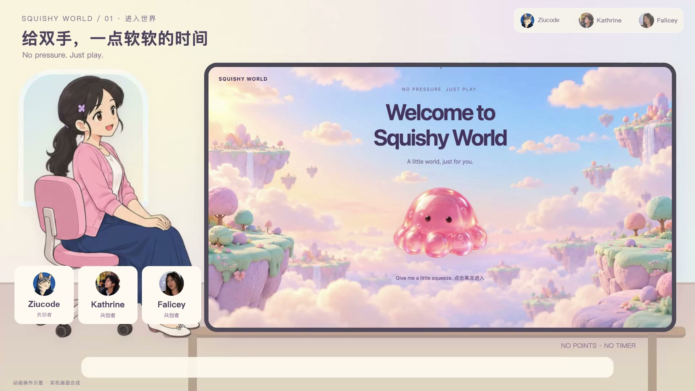
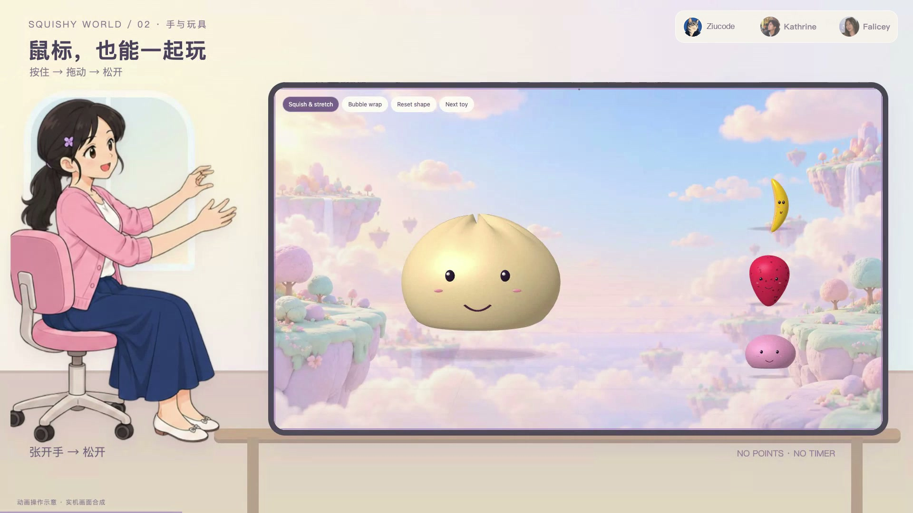

# Squishy World

**No pressure. No rules. Just play.**

A hand-gesture and mouse-controlled digital playground for squeezing, stretching, and playing with soft virtual objects.

**Second Prize · 17 October 2026 · US-university alumni hackathon, Zhangjiang, Shanghai**

[中文介绍](README.zh-CN.md) · [Five-minute demo video](https://github.com/ziucode/squishy-world-showcase/releases/download/demo-2026-11-03/Squishy-World-5min-Ziucode-Mandarin.mp4) · [Team and contributions](CREDITS.md)

## Watch the project

**[Open the video release](https://github.com/ziucode/squishy-world-showcase/releases/tag/demo-2026-11-03)** or **[download the MP4](https://github.com/ziucode/squishy-world-showcase/releases/download/demo-2026-11-03/Squishy-World-5min-Ziucode-Mandarin.mp4)**.

The film is **5:00**, with Mandarin narration, Chinese captions, and creator credits. Format: 1920 × 1080, H.264 video and AAC audio. The MP4 opens in a compatible video player; GitHub may download it instead of playing it inline.

The film combines recorded prototype visuals, scripted interactions, an illustrated presenter, and illustrated use-case scenarios. It is a project demonstration, not a recording of a deployed public service or an external user study.

| Time | Chapter |
|---|---|
| 00:00 | Welcome to Squishy World |
| 00:21 | Aiming, squeezing, stretching, releasing; mouse fallback |
| 01:10 | Two-hand compression, punch, switching toys, and twisting |
| 02:00 | Toy themes and material responses |
| 02:55 | Bubble wrap and tactile sound |
| 03:28 | Free play and the optional challenge |
| 03:40 | Illustrated everyday-use scenarios |
| 04:35 | Creators and closing |

## The idea

Squishy World brings the small pleasures of a squishy toy, soft putty, and bubble wrap into a playful digital environment. The experience centres on a simple loop:

**Move your hand → squeeze or stretch → see and hear the response → let go.**

Free play avoids a compulsory score or timer. Mouse interaction offers an alternative to camera input. An optional challenge sits alongside the relaxed experience.

## What the prototype explores

- **Natural input:** camera-based hand tracking, deliberate grips, and mouse controls.
- **Visible response:** deformable objects that compress, stretch, twist, and rebound.
- **Material variety:** different recovery and deformation behaviours for jelly, foam, putty, and brittle surfaces.
- **Sensory feedback:** bubble wrap and action-linked sound.
- **A coherent world:** a soft visual identity and a gradual entrance into the playground.

## Team

This was a collaborative, AI-assisted hackathon project. The responsibilities below credit the team's different contributions.

| Creator | Contribution |
|---|---|
| **[Ziucode](https://github.com/ziucode)** | Project coordination, scene and game implementation, system integration, and on-site presentation. |
| **[Katherine](https://github.com/cyberkat07)** | Camera-based hand-gesture input, recognition logic, gesture refinement, and interaction collaboration. |
| **Falicey / Alice** | Original product concept, experience design, visual direction and assets, and presentation development. |

Katherine is credited as **Kathrine** in the original five-minute film. See [CREDITS.md](CREDITS.md) for a fuller contribution summary.

## For reviewers and applications

This repository is a public portfolio reference for the team. Its overview, video, award information, and contribution summary can be read without access to the development repository.

**Short project summary:** Squishy World is a collaborative, AI-assisted interactive prototype that translates hand gestures and mouse actions into the deformation of soft virtual objects. The team combined camera input, responsive visual and audio feedback, and a playful world design. It received Second Prize at the 17 October 2026 US-university alumni hackathon in Zhangjiang, Shanghai.

The award applies to the team's hackathon project. The five-minute film is a later project presentation, not a claim that this exact film was played during judging.

## Repository scope

**This is a public showcase, not an open-source release of the application.** It contains project descriptions, still images, contributor credits, and a video release. The application implementation remains private. This repository does not host a playable version of the game.

For project or collaboration questions, [open an issue](https://github.com/ziucode/squishy-world-showcase/issues/new).
