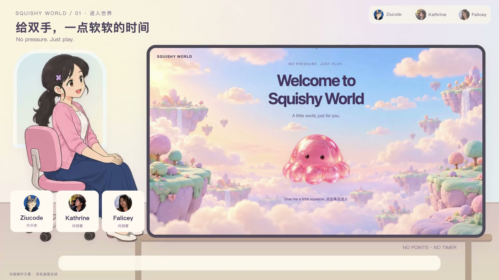
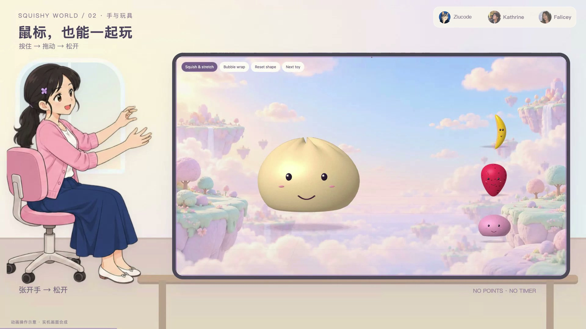

# Squishy World｜手势互动小世界

**No Pressure. No Rules. Just Play.**

用手势或鼠标捏一捏、拉一拉，让柔软的虚拟玩具产生看得见、听得见的回应。

**2026 年 10 月 17 日 · 上海张江美国高校校友黑客松 · 二等奖**

[English](README.md) · [五分钟演示视频](https://github.com/ziucode/squishy-world-showcase/releases/tag/demo-2026-11-03) · [团队分工](CREDITS.md)

## 观看演示

**[打开视频发布页](https://github.com/ziucode/squishy-world-showcase/releases/tag/demo-2026-11-03)**，或 **[下载五分钟 MP4](https://github.com/ziucode/squishy-world-showcase/releases/download/demo-2026-11-03/Squishy-World-5min-Ziucode-Mandarin.mp4)**。

时长 **5:00**，普通话旁白、中文字幕，保留三位创作者的署名。视频规格为 1920 × 1080、H.264 / AAC。GitHub 可能直接下载 MP4；下载后可用兼容播放器观看。

视频结合了原型画面、脚本化交互、插画人物和使用情境示意。它展示项目设计与原型表现，不代表已上线的公共服务或外部用户研究结果。

| 时间 | 内容 |
|---|---|
| 00:00 | 进入 Squishy World |
| 00:21 | 瞄准、抓握、拉伸、松开与鼠标操作 |
| 01:10 | 双掌夹压、拳击、切换玩具与扭转 |
| 02:00 | 玩具主题与不同材质 |
| 02:55 | 泡泡纸与互动声音 |
| 03:28 | 自由玩与可选挑战 |
| 03:40 | 日常使用情境示意 |
| 04:35 | 创作者与结尾 |

## 项目介绍

Squishy World 尝试把捏捏乐、软泥、泡泡纸等小玩具的互动体验搬到数字世界。核心体验是：

**移动双手 → 捏压或拉伸 → 看到和听到反馈 → 松开。**

自由玩不强制计分或倒计时。鼠标提供摄像头之外的操作方式；想要小目标时，可以使用独立的可选挑战。

原型探索了摄像头手势输入、软体形变、不同材质的回弹与保形、泡泡纸和动作相关声音，以及逐步进入虚拟世界的视觉体验。

## 团队分工

这是一个三人协作、使用 AI 辅助开发的黑客松项目。

| 创作者 | 主要贡献 |
|---|---|
| **[Ziucode](https://github.com/ziucode)** | 项目协调、场景与游戏实现、系统整合、现场演示。 |
| **[Katherine](https://github.com/cyberkat07)** | 摄像头手势输入、识别逻辑、手势调校与交互协作。 |
| **Falicey / Alice** | 原始产品概念、体验设计、视觉方向与素材、展示材料。 |

原五分钟视频中的署名拼写为 **Kathrine**，对应团队成员 Katherine。更多分工见 [CREDITS.md](CREDITS.md)。

## 申请材料可用简介

Squishy World 是一个三人协作、使用 AI 辅助开发的手势互动原型。项目把摄像头识别到的手部动作和鼠标操作转化为虚拟玩具的捏压、拉伸、扭转和回弹，并结合视觉与声音反馈。团队将手势输入、软体互动和虚拟世界体验整合为同一个项目，获得 2026 年 10 月 17 日上海张江美国高校校友黑客松二等奖。

奖项属于团队的黑客松项目；这里的五分钟视频是后续整理的项目介绍，不表示评委当时观看了这一个版本。

## 公开范围

**本仓库用于公开展示，不是应用源码开源仓库。** 这里提供项目介绍、演示截图、团队贡献与演示视频。应用实现仍保持私有，本仓库不提供可直接游玩的游戏。

项目交流与合作咨询可通过 [GitHub Issue](https://github.com/ziucode/squishy-world-showcase/issues/new) 联系。
